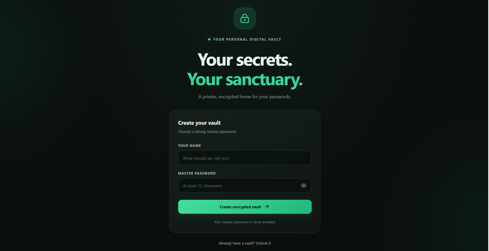
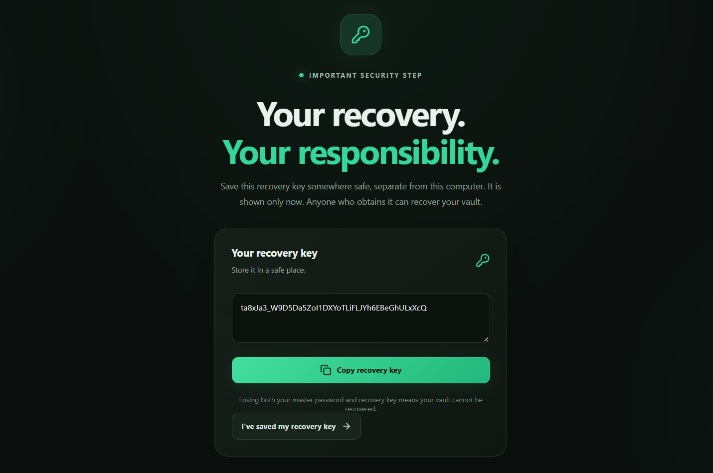
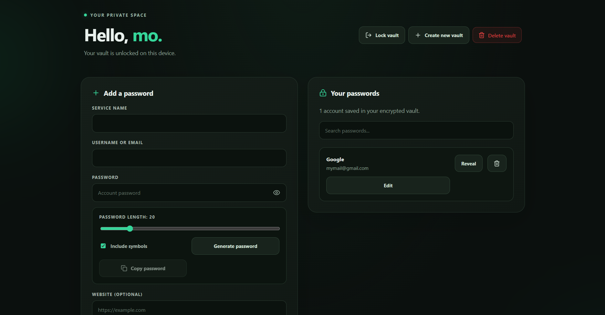

Velora 🔐

Your secrets. Your sanctuary.

Velora is a desktop password manager that stores your passwords locally in an encrypted vault, with master-password protection and recovery-key support.

Features:

    🔒 Encrypted local password storage
    🔑 Master password and recovery key
    🎲 Secure password generator
    📴 Local-first, offline-focused design

Download link:

  

!Velora Welcome Screen

!Once the vault has been created you are given a backup security key , Make sure to save it ! As well as the password you used , these are your only access methods , once lost there's no other access possiblity.

!Velora Vault

Built With

React · TypeScript · Vite · Tauri 2 · Rust
